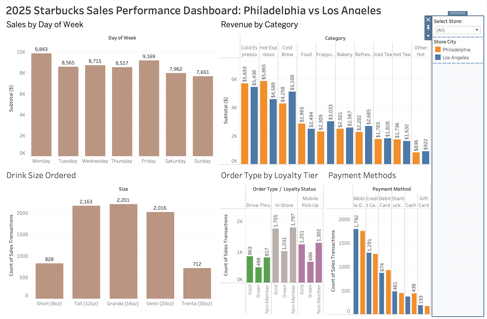
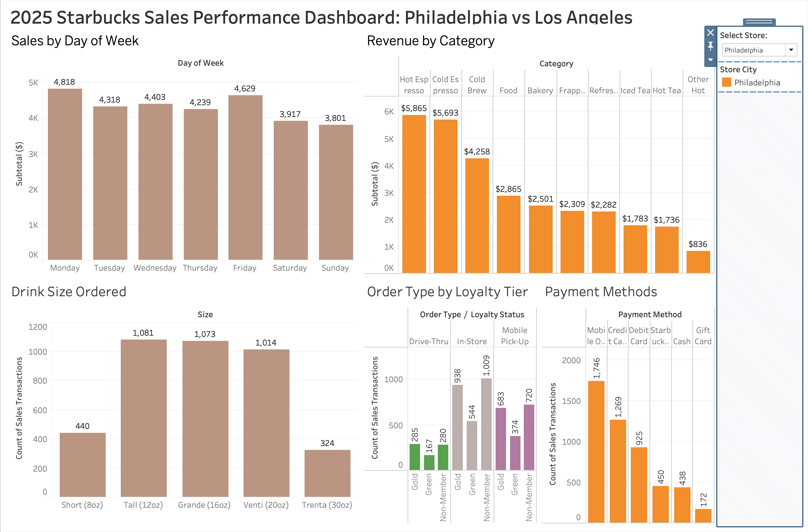
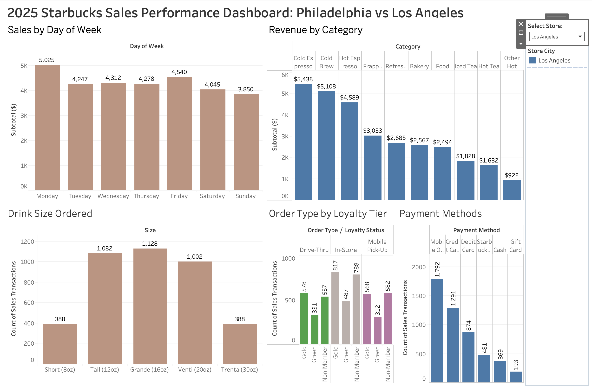

# Starbucks Sales Performance Dashboard

An interactive Tableau dashboard analyzing 10,000 sample sales transactions from two Starbucks-style stores (Philadelphia and Los Angeles) in 2025.

## Questions Explored
- Which days of the week bring in the most sales?
- Which product categories generate the most revenue, and does this differ by store?
- What drink sizes do customers order most?
- Is there a relationship between loyalty tier and order type?
- How do customers pay at each store?

## Key Findings
- Weekday sales are higher than weekend sales, with Monday the busiest day.
- Demand follows the climate: hot espresso leads in Philadelphia, while Los Angeles sells more cold drinks such as Cold Brew, Frappuccinos and Refreshers.
- Grande is the most popular drink size, followed closely by Tall and Venti.
- Order type looks similar across loyalty tiers: in-store is most common for every group.
- Mobile Order is the top payment method at both stores.

## Interactive Features
- **Store filter:** a dropdown that updates every chart for Philadelphia, Los Angeles, or both.
- **Click-to-filter:** clicking a day of the week filters all other charts to that day.

## Store Filter Examples
**Philadelphia**

**Los Angeles**

## Tools
Tableau Public, Excel

## Data
Simulated sample dataset of 2025 Starbucks-style sales (10,000 transactions). This is practice data, not official Starbucks data. Sales are shown before tax.
